# DoomCube-2 photos

Photos of the [DoomCube-2 build](../README.md). Click a filename to open the original exported image.

| Photo | View |
| --- | --- |
| 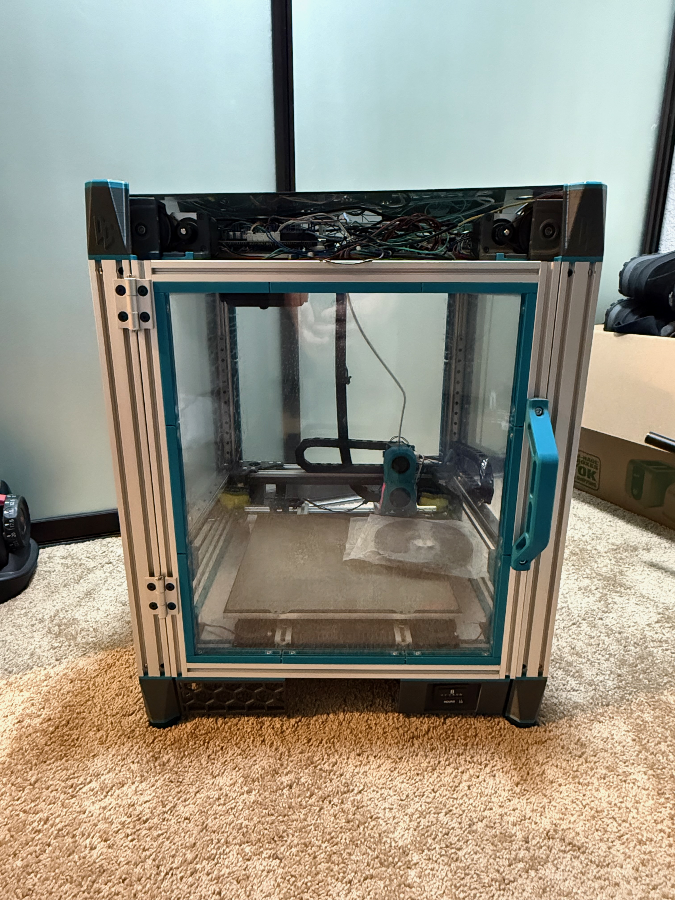 | [IMG_5060.jpeg](IMG_5060.jpeg) — Full enclosure, front view. |
| 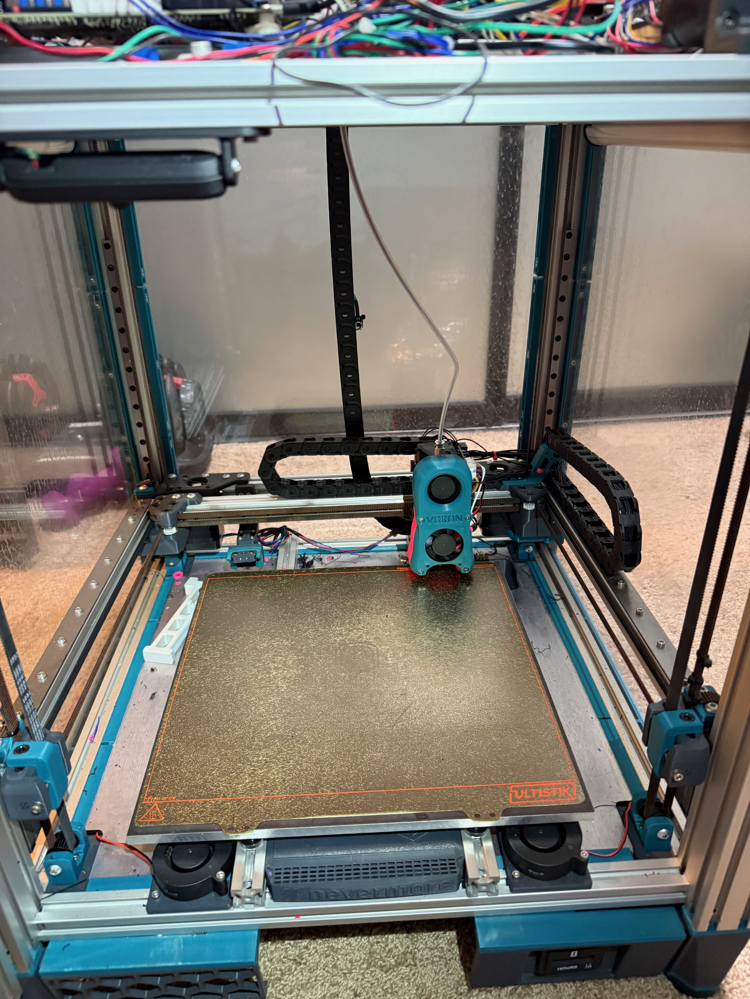 | [IMG_5051.jpeg](IMG_5051.jpeg) — Printer interior and build plate. |
| 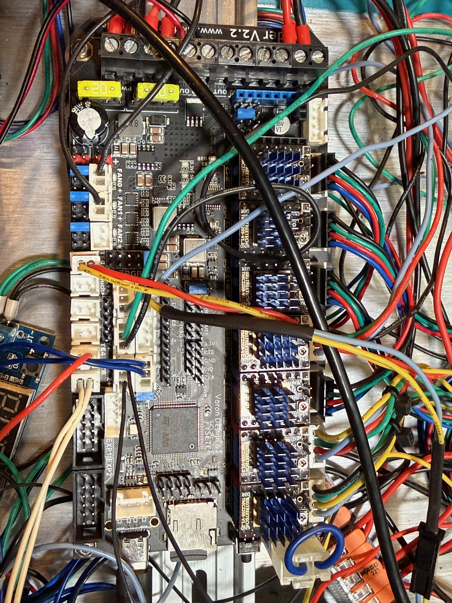 | [IMG_5052.jpeg](IMG_5052.jpeg) — Main controller and wiring. |
| 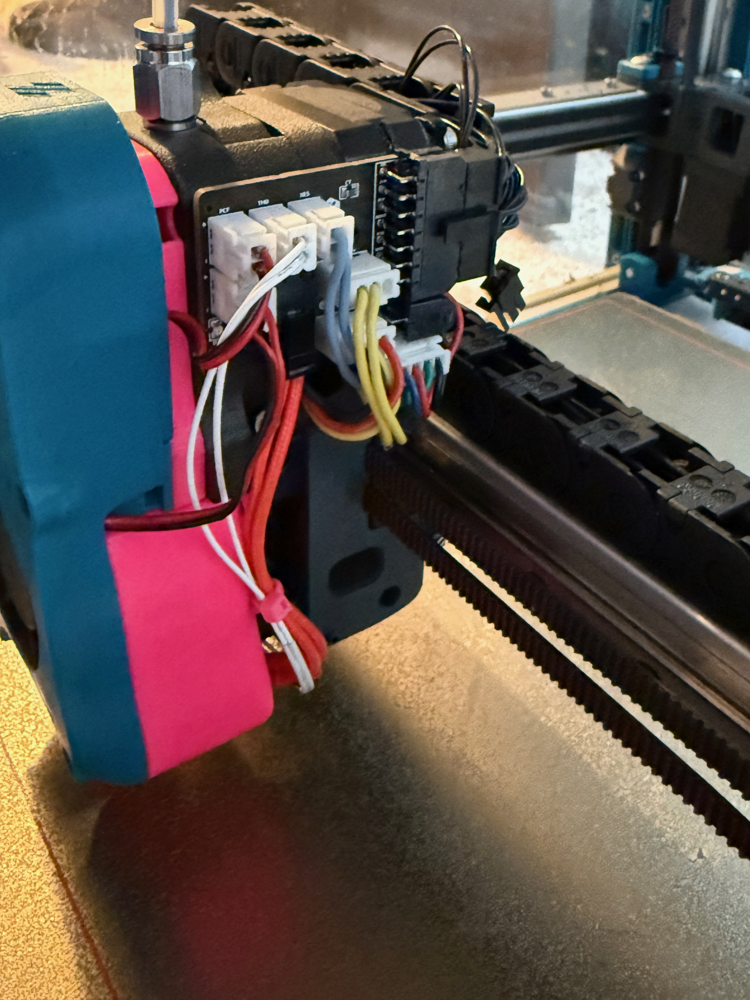 | [IMG_5053.jpeg](IMG_5053.jpeg) — Toolhead PCB and wiring. |
| 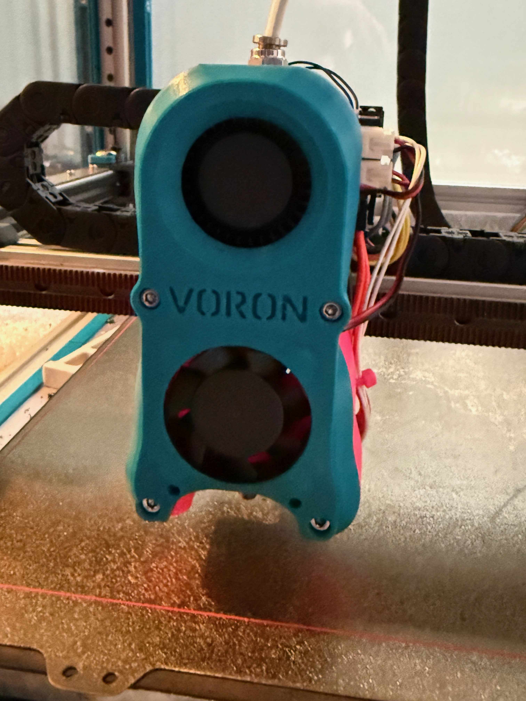 | [IMG_5054.jpeg](IMG_5054.jpeg) — Toolhead, front view. |
| 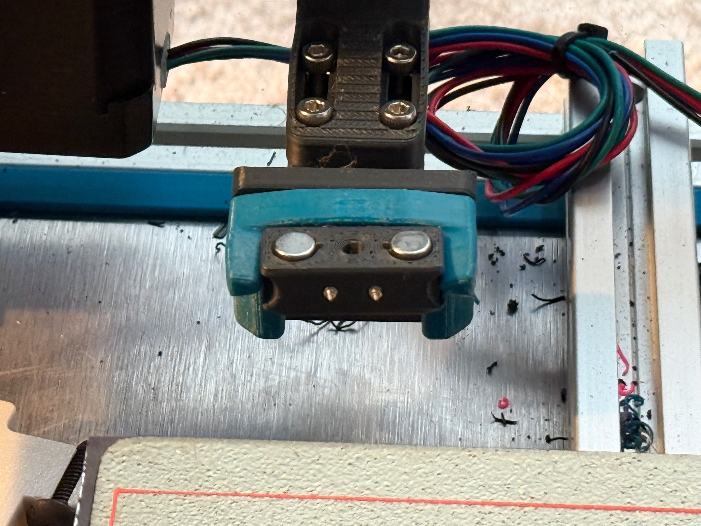 | [IMG_5055.jpeg](IMG_5055.jpeg) — Magnetic probe and dock. |
| 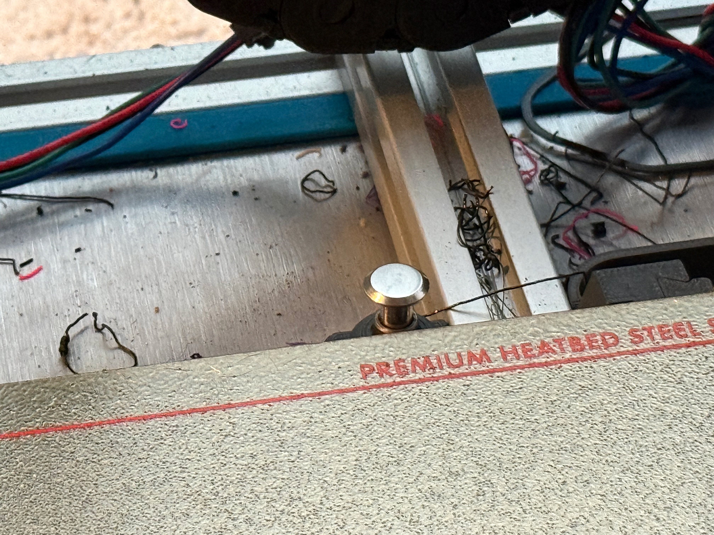 | [IMG_5056.jpeg](IMG_5056.jpeg) — SexBolt Z endstop. |
| 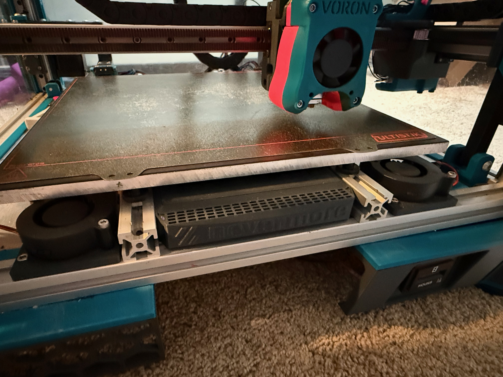 | [IMG_5057.jpeg](IMG_5057.jpeg) — Custom bed fans and Nevermore filter. |
| 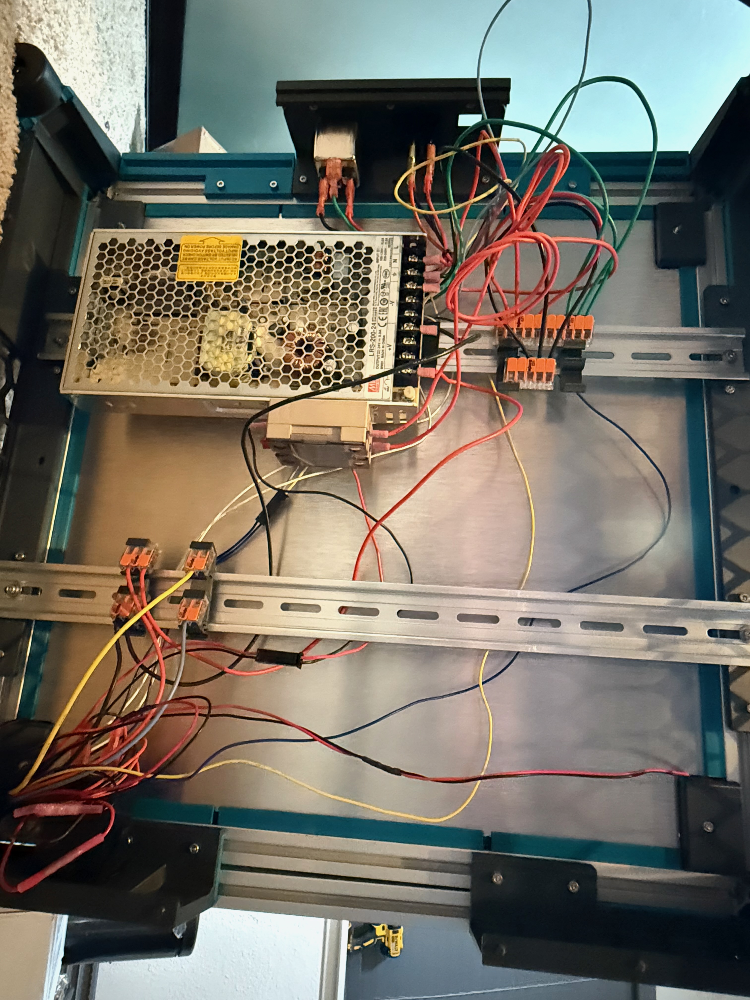 | [IMG_5058.jpeg](IMG_5058.jpeg) — Power supply and wiring. |
| 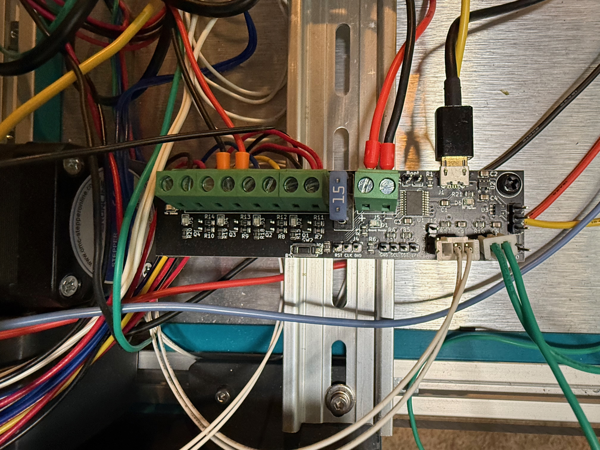 | [IMG_5059.jpeg](IMG_5059.jpeg) — Expansion PCB. |
| 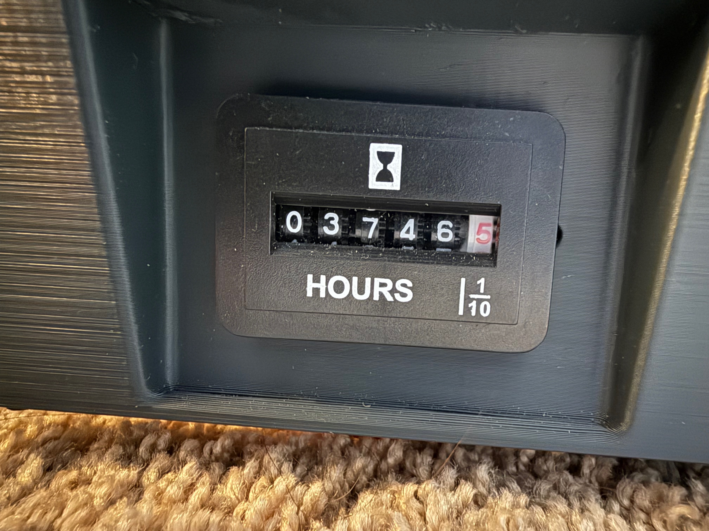 | [IMG_5062.jpeg](IMG_5062.jpeg) — Custom mechanical hour counter. |

The original filenames and image files are preserved.
